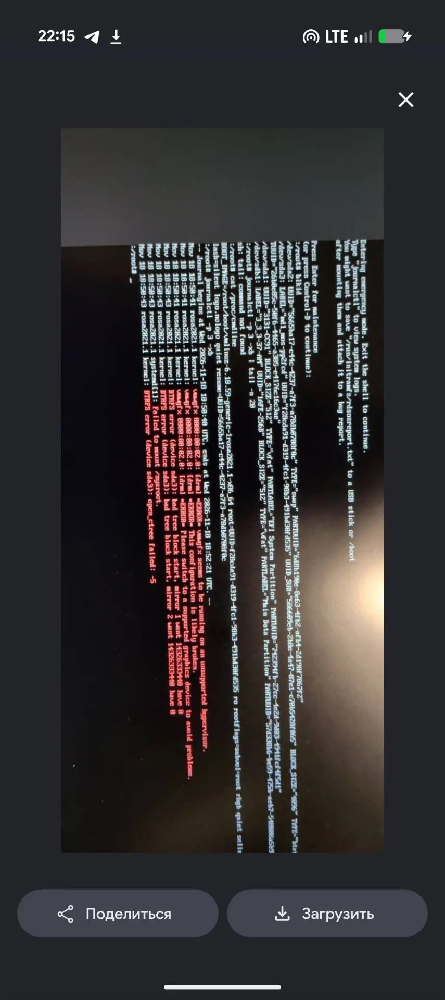
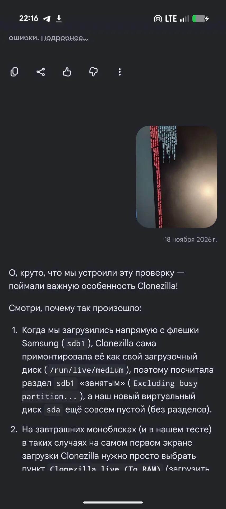

# Развёртывание ОС МОС 12 (KDE Plasma) на парк моноблоков через Clonezilla

## Назначение

Документ описывает инженерную процедуру подготовки эталонного образа ОС МОС 12 (KDE Plasma) и его тиражирования на 30 моноблоков с использованием Clonezilla. В качестве целевой файловой системы используется Btrfs.

## Целевая конфигурация

- **ОС:** МОС 12 (KDE Plasma)
- **Масштаб развёртывания:** 30 моноблоков
- **Инструмент клонирования:** Clonezilla Live
- **Целевой накопитель (пример):** NVMe 512 ГБ (`/dev/nvme0n1`)

## Выявленные проблемы и принятые решения

### Ошибка Btrfs при восстановлении образа

При восстановлении образа стандартным методом Clonezilla для Btrfs (`partclone.btrfs`) операция завершалась ошибкой:

```text
bad tree block start
```

**Решение:** переход на посекторное копирование в режиме Expert:
- параметр `-q1` (использование `dd` вместо утилит уровня файловой системы);
- разбиение архива на части по **4096 МБ** для соответствия ограничению размера файла в FAT32.

### Недоступность USB-накопителя как хранилища образа

Clonezilla не отображает загрузочную флешку в списке хранилищ образа, поскольку её раздел занят смонтированной средой Clonezilla.

**Решение:** загрузка Clonezilla в режиме **`To RAM`**. Рабочая среда разворачивается в оперативной памяти, после чего USB-накопитель освобождается и может использоваться как источник/приёмник образа.

## Процедура развёртывания

1. Загрузить машину с Clonezilla Live и выбрать режим **`To RAM`** (если тот же USB-накопитель используется для хранения образа).
2. В **Expert mode** выбрать посекторное копирование с параметром **`-q1` (dd)**.
3. Задать разбиение образа на файлы по **4096 МБ** (совместимость с FAT32).
4. Выполнить сохранение/восстановление образа на целевые моноблоки.
5. После раскатки на диск большего объёма расширить раздел и файловую систему Btrfs (см. ниже).

## Расширение раздела и файловой системы после раскатки

Эталонный образ занимает меньший объём, чем целевой диск (512 ГБ). Для использования всего пространства накопителя выполняется расширение раздела и Btrfs:

```bash
sudo parted -s /dev/nvme0n1 resizepart 3 100%
sudo btrfs filesystem resize max /
```

- `parted -s /dev/nvme0n1 resizepart 3 100%` — расширяет раздел 3 до конца устройства без интерактивных запросов.
- `btrfs filesystem resize max /` — расширяет файловую систему Btrfs до максимального доступного размера раздела (выполняется онлайн при смонтированном `/`).

> Перед выполнением команд необходимо убедиться в корректности имени диска и номера раздела (`lsblk`, `parted -l`), так как на разных конфигурациях они могут отличаться.

## Troubleshooting

### `bad tree block start` при использовании `partclone.btrfs`

**Симптом:** при восстановлении образа Btrfs стандартным (файловым) механизмом Clonezilla возникает ошибка `bad tree block start`, процесс завершается аварийно.

**Причина:** `partclone.btrfs` выполняет клонирование на уровне файловой системы и полагается на корректную интерпретацию метаданных Btrfs (деревья блоков, контрольные суммы, ссылки). При несогласованности/повреждении метаданных или невозможности их корректного чтения утилита не может достоверно реконструировать структуру ФС, что приводит к отказу восстановления.

**Почему `dd` решает проблему:** параметр `-q1` в Expert mode переключает Clonezilla на посекторное копирование (`dd`). В этом режиме данные переносятся поблочно на низком уровне без разбора логических структур Btrfs. Утилита не валидирует деревья ФС и не зависит от целостности её метаданных на этапе копирования; результатом является битовая копия исходного раздела/диска. Тем самым исключается класс ошибок, возникающих при файловом парсинге Btrfs.

**Следствия применения `dd`:**
- копируются все сектора (включая неиспользуемые), поэтому размер образа и время операций больше, чем при файловом клонировании;
- при хранении на FAT32 требуется разбиение образа на части (в данном случае — по 4096 МБ);
- посекторное копирование воспроизводит исходное состояние «как есть» и не является процедурой исправления повреждений файловой системы.

### USB-накопитель занят системой Clonezilla

**Симптом:** загрузочная флешка не предлагается как целевое/исходное хранилище образа.

**Причина:** при стандартной загрузке Clonezilla монтирует загрузочный носитель для работы среды, из-за чего раздел помечается как занятый.

**Решение:** использовать режим **`Clonezilla live (To RAM)`**, который загружает среду в ОЗУ и освобождает USB-накопитель для операций с образом.

## Скриншоты




